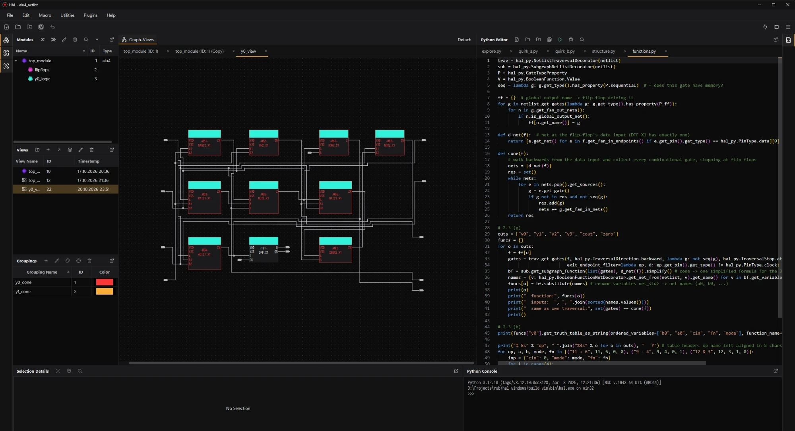

# HAL for Windows

A Windows-native fork of [HAL](https://github.com/emsec/hal), the hardware analyzer for netlist reverse engineering. It builds with MSVC, has a rebuilt interface and uses the editor of VS Code for scripts.



## Install

Download `HALSetup.exe` from the [latest release](../../releases/latest) and run it. There is also `HAL-portable.zip` if you prefer a folder. Windows 10 or 11, 64-bit. Python and Qt are included.

## Use

Start **HAL** from the Start menu, or run `hal-gui.exe`. Open a project folder, or drop a netlist (Verilog, VHDL) onto the start page to create one.

The Python editor on the right runs your script against the loaded netlist and completes HAL's API as you type. Double-click a tab to rename it.

The command line works without the interface:

```powershell
hal.exe -p path\to\project --python-script analyze.py
hal.exe --help
```

## Differences from upstream

- Native Windows build, no WSL
- New look: dark theme, one icon set, notifications instead of pop-ups
- Monaco (the editor of VS Code) for Python scripts
- Not ported yet: the simulator, dataflow analysis, clock tree and a few other plugins

## Build

You need Visual Studio 2022 with the C++ workload and Python 3.12.

```powershell
powershell -ExecutionPolicy Bypass -File tools\windows\get-deps.ps1
powershell -ExecutionPolicy Bypass -File tools\windows\build.ps1
powershell -ExecutionPolicy Bypass -File tools\windows\package.ps1
```

`get-deps.ps1` downloads Qt and the other libraries once. `build.ps1 -Run` builds and starts the GUI, `package.ps1` creates `dist\HALSetup.exe`. Every push builds a release on GitHub.

## Credits

HAL is developed by the Embedded Security group at the Max Planck Institute for Security and Privacy and Ruhr University Bochum ([documentation](https://github.com/emsec/hal/wiki)). This fork is MIT licensed like the original. It includes [Monaco](https://github.com/microsoft/monaco-editor) (MIT) and [Lucide](https://lucide.dev) icons (ISC).
